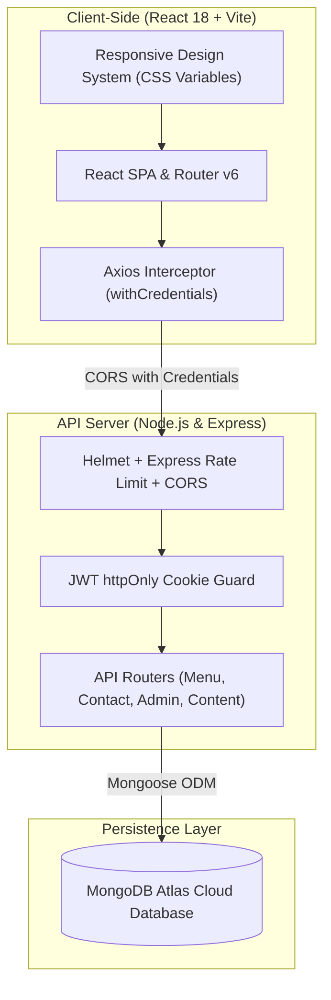

# The Cozy Beans — Full-Stack Restaurant & Cafe Management Platform

[](https://react.dev)
[](https://nodejs.org)
[](https://expressjs.com)
[](https://www.mongodb.com)
[](https://thecozybeans.netlify.app)
[]()

A modern, responsive, full-stack **Restaurant & Cafe Ordering Management Platform** built with the **MERN stack** (MongoDB, Express, React, Node.js). Features customer-facing categorized menu browsing, dynamic contact management with interactive Google Maps integration, and an administrative control panel with JWT cookie authentication, real-time message moderation, and CMS content editing.

---

## Live Deployments & Preview
- **Public Customer Portal (Netlify):** [thecozybeans.netlify.app](https://thecozybeans.netlify.app)
- **Administrative Portal:** [thecozybeans.netlify.app/admin/login](https://thecozybeans.netlify.app/admin/login)

---

## System Architecture



---

## Core Features

### 1. Public Customer Experience
- **Interactive Menu Showcase:** Filterable categorized offerings (Breakfast, Lunch, Drinks, Desserts) with popularity badges and dynamic pricing.
- **Dynamic Story & About Page:** Company story and philosophy with interactive, animated value proposition cards.
- **Location & Contact Integration:** Real-time business hours, dynamic phone/email links, and interactive Google Maps embed.
- **Customer Inquiry Desk:** Validated contact submission form dispatching inquiries directly to the administrative inbox.
- **Responsive Architecture:** Pixel-perfect layout adaptation from 320px mobile viewports up to 4K ultra-wide screens.

### 2. Administrative Control Suite (`/admin`)
- **Executive Metric Dashboard:** Live overview cards summarizing total menu offerings, message activity, and category distribution.
- **Menu Catalog Management:** Real-time CRUD operations to add, modify, preview, price, and flag featured dishes.
- **Inquiry Inbox & Moderation:** Read, filter, toggle read/unread status, and archive incoming customer feedback.
- **Content Management (CMS):** Edit story text, upload showcase banners, and configure opening hours without rebuilding frontend assets.
- **Collapsible Responsive Navigation:** Desktop icon-only sidebar minimizing screen footprint, converting to an overlay drawer on mobile viewports.

---

## Technology Stack

| Layer | Technologies |
|---|---|
| **Frontend Framework** | React 18, Vite, React Router v6, Axios |
| **Styling & Design System** | Native Modern CSS (CSS Variables, Flexbox, CSS Grid, ScrollReveal Animations) |
| **Backend Runtime** | Node.js, Express.js |
| **Database & ODM** | MongoDB Atlas, Mongoose ODM |
| **Authentication & Security** | JWT (httpOnly Secure Cookies), bcryptjs password hashing, Helmet, Express Rate Limit, CORS |
| **Hosting & Deployment** | Netlify (Frontend SPA), Cloud Node Server |

---

## RESTful API Specifications

| Method | Endpoint | Access Level | Description |
|---|---|---|---|
| `GET` | `/api/health` | Public | Automated health and readiness check |
| `GET` | `/api/menu` | Public | Fetch all categorized menu offerings |
| `GET` | `/api/menu/popular` | Public | Retrieve curated customer favorites |
| `POST` | `/api/contact` | Public | Dispatch customer contact inquiry |
| `GET` | `/api/about` | Public | Retrieve dynamic About story and value cards |
| `GET` | `/api/settings` | Public | Fetch hours, location coordinates, and metadata |
| `POST` | `/api/admin/login` | Public | Authenticate administrator & set httpOnly cookie |
| `POST` | `/api/admin/logout`| Admin | Clear active session cookie |
| `GET` | `/api/admin/me` | Admin | Validate active session token |
| `POST` | `/api/menu` | Admin | Add new menu item to catalog |
| `PUT` | `/api/menu/:id` | Admin | Update existing menu pricing and details |
| `DELETE`| `/api/menu/:id` | Admin | Remove dish from catalog |
| `GET` | `/api/contact` | Admin | List all received customer feedback |
| `PATCH` | `/api/contact/:id`| Admin | Toggle message read/unread status |
| `DELETE`| `/api/contact/:id`| Admin | Delete message |

---

## Project Structure

```
simple-cafe-management/
├── client/                           # React 18 frontend (Vite)
│   ├── src/
│   │   ├── components/               # Navbar, Footer, Hero, MenuItemCard, ContactForm
│   │   ├── pages/                    # Home, About, Menu, Contact
│   │   │   └── admin/                # AdminDashboard, MenuManager, Messages, Settings
│   │   ├── hooks/                    # useAuth, useScrollReveal
│   │   ├── api.js                    # Axios instance configured with withCredentials
│   │   └── index.css                 # Complete design system & custom properties
│   └── package.json
├── server/                           # Express backend
│   ├── middleware/                   # JWT authentication & rate limiters
│   ├── models/                       # MenuItem.js, Message.js, Admin.js, SiteSettings.js
│   ├── routes/                       # menuRoutes, contactRoutes, adminRoutes
│   ├── server.js                     # Application entry point
│   └── package.json
├── start-servers.ps1                 # Windows dual-server bootstrapper
└── netlify.toml                      # Netlify SPA redirect rules
```

---

## Local Development & Setup

### Prerequisites
- Node.js `>= 18.x`
- MongoDB database (local instance or MongoDB Atlas connection URI)

### Setup Instructions

```bash
# 1. Clone repository
git clone https://github.com/alramim07/simple-cafe-management.git
cd simple-cafe-management

# 2. Install backend dependencies
cd server
npm install

# 3. Configure backend environment (server/.env)
# PORT=5000
# MONGO_URI=your_mongodb_atlas_connection_string
# CLIENT_URL=http://localhost:5173
# JWT_SECRET=your_jwt_private_secret_key
# ADMIN_EMAIL=admin@example.com
# ADMIN_PASSWORD=YourSecurePassword123!

# 4. Initialize administrator account & seed menu data
npm run create-admin
npm run seed

# 5. Install frontend dependencies
cd ../client
npm install

# 6. Configure frontend environment (client/.env)
# VITE_API_URL=http://localhost:5000

# 7. Start both servers concurrently
# On Windows PowerShell:
.\start-servers.ps1

# Or run separately:
# Terminal 1: cd server && npm run dev
# Terminal 2: cd client && npm run dev
```

- Public Frontend: **`http://localhost:5173`**
- Administrative Suite: **`http://localhost:5173/admin/login`**

---

## License
This project is open-source software licensed under the [MIT License](LICENSE).
